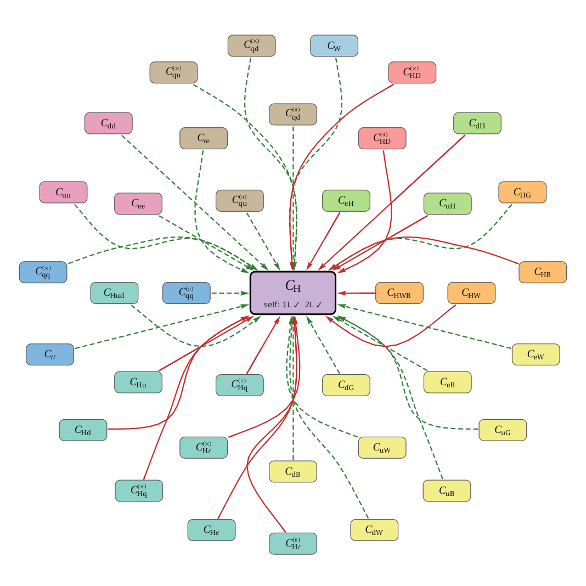
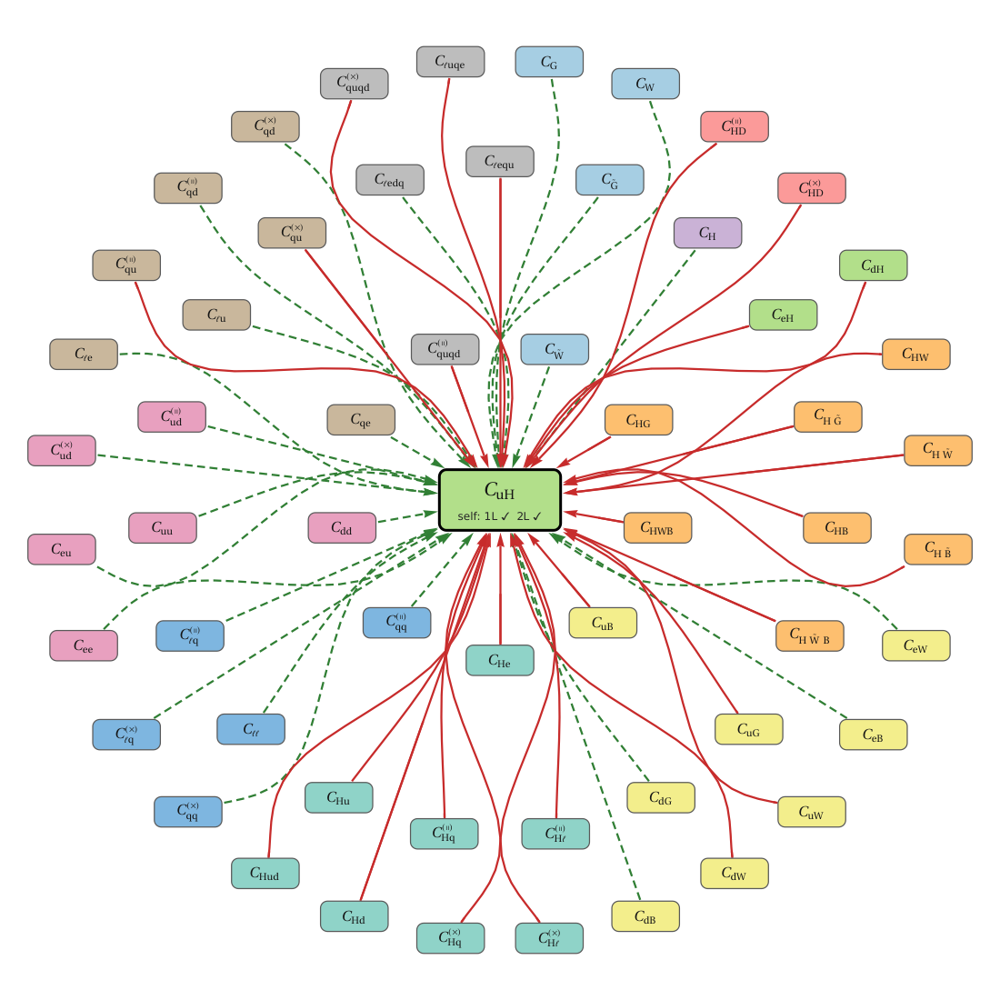
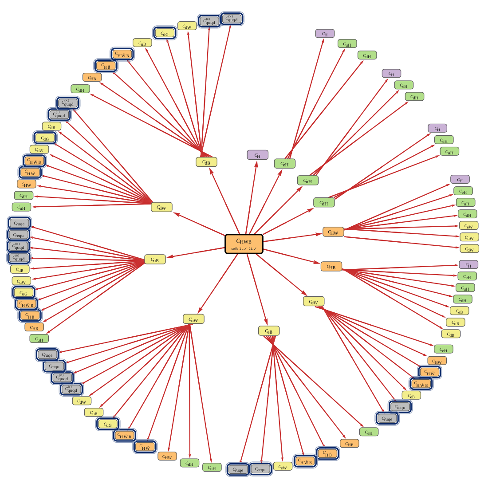
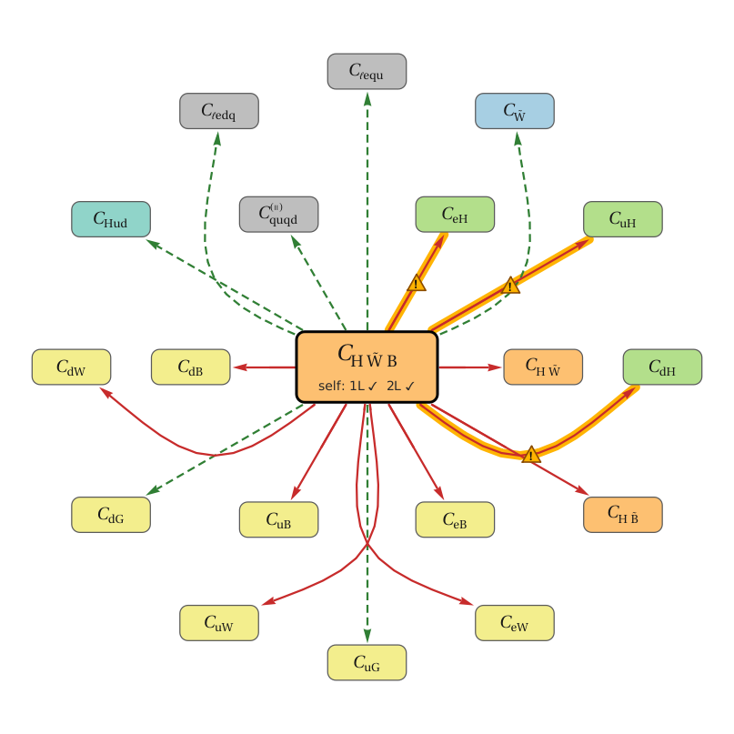
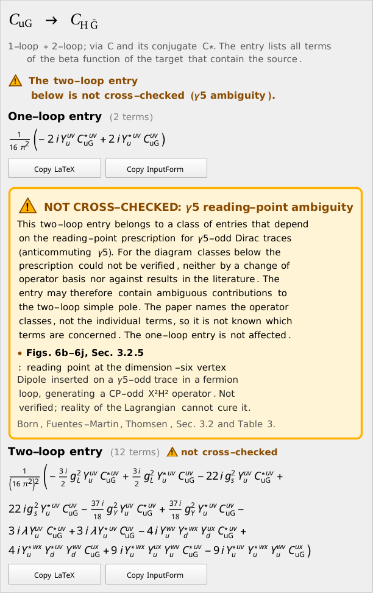
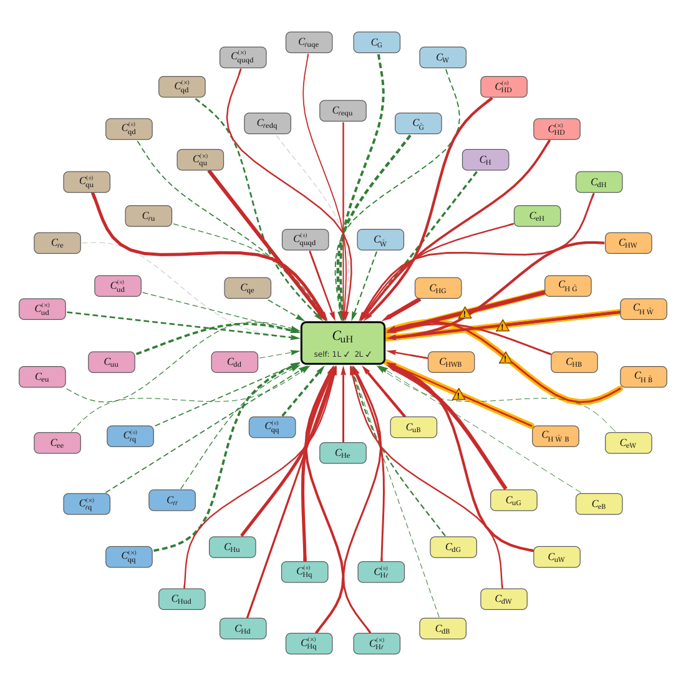
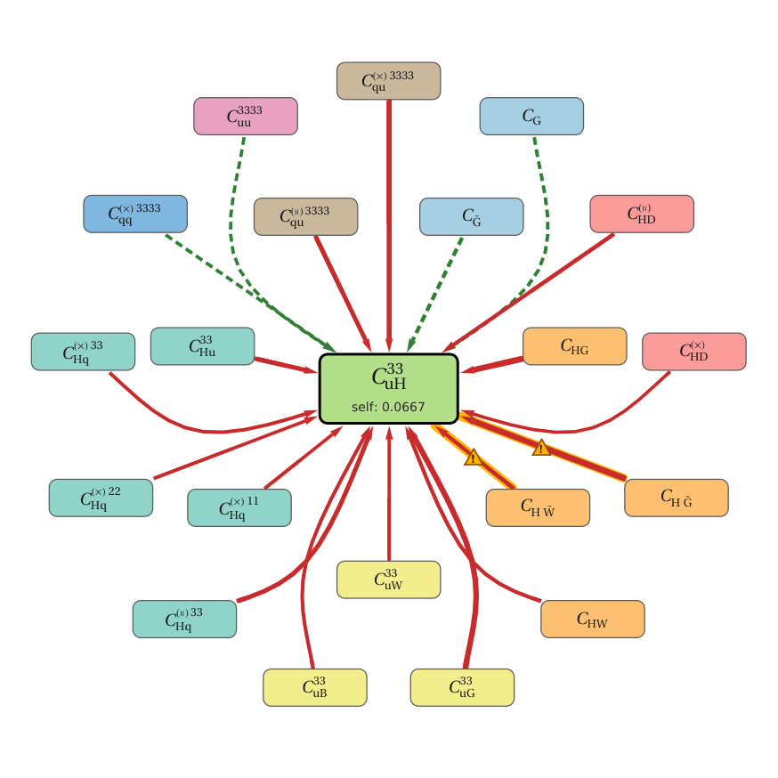
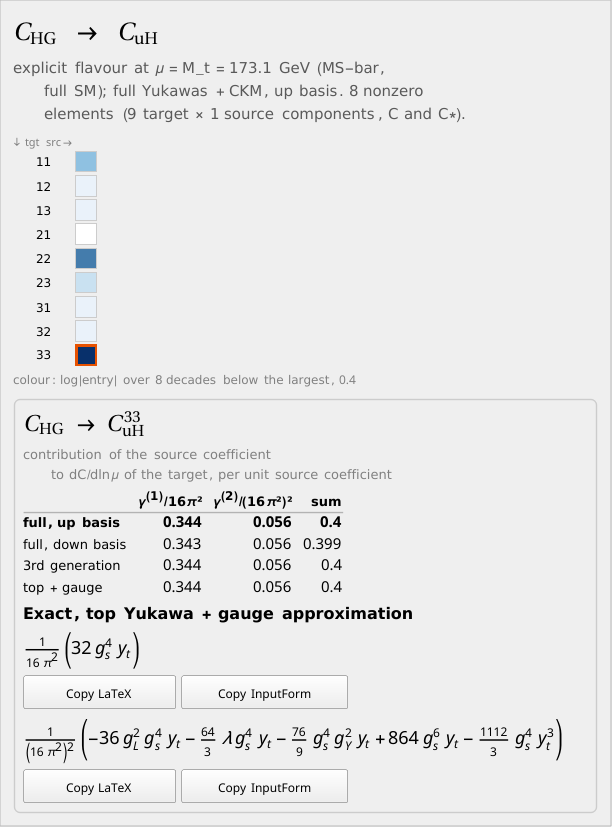
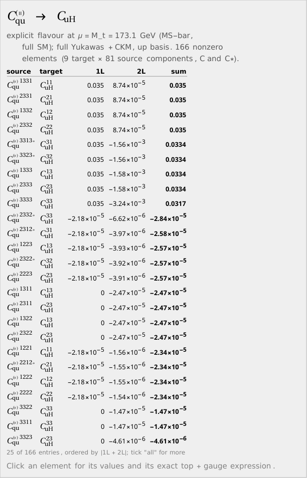
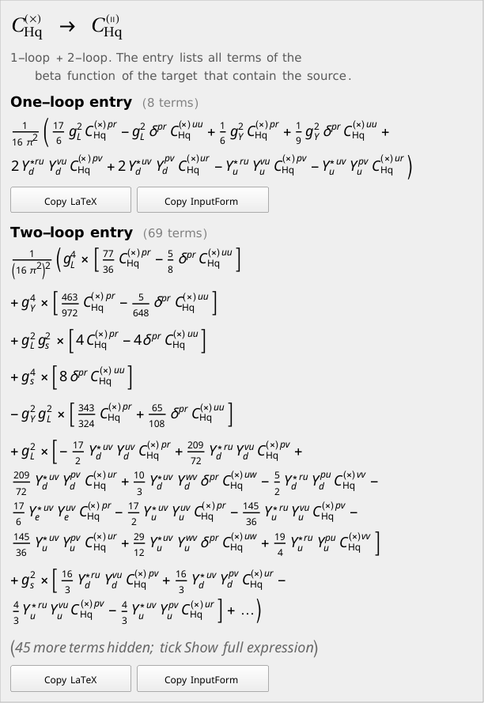

# SMEFT ADM Explorer

**An interactive map of how dimension-six SMEFT operators mix under renormalization-group running, at one and two loops.**

Pick an operator and see which operators it runs into, or which operators generate it. Click any arrow to read the full anomalous-dimension entry, typeset and ready to copy as LaTeX or Mathematica code.



The data are the one- and two-loop beta functions of the dimension-six SMEFT in the **Mainz basis**, from Born, Fuentes-Martín and Thomsen, [Next-to-Leading Order Running in the SMEFT](https://arxiv.org/abs/2601.19974).

## Getting started

**Requirements:** Mathematica 14.2 or newer (with the front end). Nothing else: no Matchete, no extra packages, no internet connection.

1. Download these **four files** into the **same folder** (or simply clone or download the whole repository):
   * `SMEFT_ADM_Explorer.nb`: the notebook
   * `SMEFTADMExplorer.m`: the code
   * `ADMData.wxf`: the preprocessed data
   * `FlavorADMData.wxf`: the explicit-flavour numbers (optional; without it the explorer works, but without the explicit-flavour features)
2. Open `SMEFT_ADM_Explorer.nb` in Mathematica. Its single input cell loads the code and data from the notebook's folder and starts the explorer; it runs on open. If your Mathematica asks whether to evaluate initialization cells, accept; otherwise evaluate the cell by hand with Shift+Enter.

The first view is centered on C<sub>H</sub>. Everything else is point and click. If the explorer does not appear, check that the files really are in the same folder: the notebook looks for the others next to itself.

## What you see

| | |
|---|---|
| **Nodes** | the 59 operators, colored by operator class |
| **Red arrow** | the mixing is nonzero at one loop (a two-loop part may exist as well) |
| **Green dashed arrow** | the mixing first appears at two loops |
| **Amber band and warning triangle** | (*1-loop + 2-loop* mode) the two-loop part of this entry is **not cross-checked**, see [below](#two-loop-entries-that-are-not-cross-checked) |
| **Navy halo** | (*1-loop squared* mode) an operator reached only through a chain of two one-loop steps, i.e. genuinely new at order (γ<sup>(0)</sup>)<sup>2</sup> |
| **Chains as a tree** | (*1-loop squared* mode) the center, then the operators it runs into on a first ring, then, behind each of those, its own copies of the operators *it* runs into on an outer circle. An operator reached through several intermediate operators therefore appears several times, once per intermediate operator, and no arrow crosses another. At first only the first ring is shown; the number on a first-ring operator is the size of its branch |
| **Badge on the center** | whether the operator mixes into itself at one and two loops (for the dipoles it carries the warning "2L unchecked") |

Operators with many neighbors are spread over up to three rings, ordered by class. Arrows to outer rings are longer but never cross another operator.

| Many neighbors (here 56) | Chains of two one-loop steps (tree) |
|---|---|
|  |  |

## Two-loop entries that are not cross-checked

The two-loop calculation uses an anticommuting γ<sub>5</sub> (NDR). γ<sub>5</sub>-odd Dirac traces then depend on the reading point, and the paper fixes it by a prescription (Sec. 3.2). The prescription was verified for most diagram classes, but **not** for the classes of Table 3 / Sec. 3.2.8, which only affect the two-loop simple poles (the one-loop entries are unaffected). The explorer marks the two-loop entries of these classes:

| Class (Table 3) | Diagram | Marked entries |
|---|---|---|
| ψ²XH → ψ²XH | Figs. 6a, 7 | dipole → dipole, including the self-running of the dipoles (48 arrows + 8) |
| ψ²XH → CP-odd X²H² | Figs. 6b-6j | dipole → C<sub>HG̃</sub>, C<sub>HW̃</sub>, C<sub>HB̃</sub>, C<sub>HW̃B</sub> (30 arrows) |
| ψ²XH → CP-odd X³ | Fig. 6k | dipole → C<sub>G̃</sub>, C<sub>W̃</sub> (5 arrows) |
| H²X² → ψ²H³ | Fig. 8e | C<sub>HG̃</sub>, C<sub>HW̃</sub>, C<sub>HB̃</sub>, C<sub>HW̃B</sub> → C<sub>eH</sub>, C<sub>uH</sub>, C<sub>dH</sub> (12 arrows) |
| ψ²H³ → CP-odd X²H² | Fig. 5 | no entry in the data |
| scalar ψ⁴ → CP-odd X²H² | Fig. 3b | no entry in the data (the prescription gives no contribution) |

* **In the graph** (*1-loop + 2-loop* mode): an amber band under the arrow and a warning triangle on it. The checkbox *mark entries not cross-checked* switches this off.
* **In the side panel**: clicking such an arrow shows an amber warning box directly above the two-loop entry (with the diagram class, the prescription and the reason), and a short note at the top of the panel. The tooltips of the arrow and, for the dipoles, of the center operator carry the warning too.
* **Overview**: the folding section *Two-loop entries not cross-checked* in the left column lists the table.

The classes are taken from the paper; the paper does not say *which terms* of an entry are concerned, so a marked entry **may** contain ambiguous contributions, not necessarily that all of its terms do.

| C<sub>HW̃B</sub> runs into ... | Entry of C<sub>uG</sub> → C<sub>HG̃</sub> |
|---|---|
|  |  |

## Explicit flavour

The graph above works with flavour-generic operators (C<sub>uH</sub><sup>pr</sup>, index sums written out). For phenomenology, the explorer also shows the **explicit flavour components** and their **numerical size at one reference point**: μ = M<sub>t</sub> (MS-bar). The numbers are meant as rough size estimates (no running of the SM inputs).

* **Which number?** The element of the anomalous-dimension matrix, as the contribution of a source coefficient C<sub>b</sub> to dC<sub>a</sub>/dln μ: one loop γ<sup>(1)</sup>/16π², two loops γ<sup>(2)</sup>/(16π²)², and their sum.
* **Approximations** (menu in the left column): full Yukawa matrices with the CKM matrix in the **up basis** (Y<sub>u</sub> diagonal, Y<sub>d</sub> = V diag) or the **down basis** (Y<sub>u</sub> = V<sup>†</sup> diag, Y<sub>d</sub> diagonal); **third generation** only (y<sub>t</sub>, y<sub>b</sub>, y<sub>τ</sub>, no CKM); **top Yukawa + gauge** (y<sub>t</sub>, g<sub>L</sub>, g<sub>Y</sub>, g<sub>s</sub>, λ). For the latter the exact expression of every element is shown as well.
* **Loop order**: 1-loop, 2-loop or both.

Three views use these numbers:

| | |
|---|---|
| **Explicit flavour tab** (side panel) | click an arrow of the family graph: the flavour components of that entry. Small blocks as a heat map (colour: log of the size), large ones (four-fermion operators) as a ranked list with an index filter. Click an element for its value in all four approximations and its exact top + gauge expression (copy as LaTeX or InputForm) |
| **Weighted arrows** | tick *arrow thickness: largest flavoured element*: in the *1-loop* and *1-loop + 2-loop* modes the thickness of every arrow follows the largest flavour component of its entry (log scale); arrows below the threshold slider are grey |
| **Mode *explicit flavour (numerical)*** | the center is one flavour component (menu, default the third generation, e.g. C<sub>uH</sub><sup>33</sup>), surrounded by its strongest flavoured partners (slider: how many). Thickness = size, red = nonzero at one loop, green = two loops only. Click a partner to recenter on it |

| Weighted family graph (C<sub>uH</sub>, generated by) | Focus view: C<sub>uH</sub><sup>33</sup>, generated by |
|---|---|
|  |  |

| Heat map and element: C<sub>HG</sub> → C<sub>uH</sub> | Ranked list: C<sub>qu</sub><sup>(∥)</sup> → C<sub>uH</sub> |
|---|---|
|  |  |

**Good to know**

* Components are the **independent** ones (DsixTools conventions): redundant components (e.g. C<sub>ll</sub><sup>2121</sup> = C<sub>ll</sub><sup>1212</sup>) are folded into their representative. Complex coefficients have two columns, C and C<sup>&lowast;</sup>; the rows are the C entries (the C<sup>&lowast;</sup> rows are their complex conjugates).
* The Mainz operators contain gauge couplings (e.g. O<sub>HG</sub> = g<sub>s</sub><sup>2</sup> H<sup>†</sup>H G G), so the numbers refer to the Mainz-normalised coefficients. λ is normalised as V ⊃ (λ/2)(H<sup>†</sup>H)<sup>2</sup>.
* Elements below 10<sup>−14</sup> are not stored. The Weinberg operator and the baryon-number-violating operators are not shown.
* **Reference point** (μ = M<sub>t</sub> = 173.1 GeV, full SM, MS-bar): gauge couplings, λ and running masses from Huang & Zhou, [arXiv:2009.04851](https://arxiv.org/abs/2009.04851) (Tables 2, 3, 5, 6; y<sub>f</sub> = √2 m<sub>f</sub>/246 GeV; λ = 2 × 0.12607 in the Mainz convention); CKM from PDG 2024 (Wolfenstein λ = 0.22501, A = 0.826, ρ̄ = 0.1591, η̄ = 0.3523), not run to M<sub>t</sub>. The table is also in the left column (*Reference point*).

## Using it

| Do this | To get this |
|---|---|
| Type in the search field, or use the class and operator menus | choose the center operator (`Back` returns to the previous one) |
| **Direction**: *Runs into* / *Generated by* | edges center → X, or X → center (never both at once) |
| **Mode**: *1-loop only* / *1-loop + 2-loop* / *1-loop squared* | direct one-loop edges; one- and two-loop edges; or two-step chains of one-loop edges |
| **Layout**: *Radial* / *Spring* | ordered rings, or a free-floating arrangement |
| **Show** (*1-loop squared* mode): *first ring only* / *both rings* | only the operators reached in the first step, or the full tree; instead of the layout choice |
| **Zoom** slider, scroll bars | large graphs, especially chains, are bigger than the window: scroll, or zoom out to get an overview |
| Tick or untick operator classes | hide or show whole classes |
| Hover over an arrow | the coupling combinations involved and whether it goes through the conjugate |
| **Click an arrow** | the full entry in the side panel, with *Copy LaTeX* and *Copy InputForm* buttons |
| **Click an operator** | recenter the graph on it. In the *1-loop squared* view, clicking a first-ring operator opens or closes its branch (the second-step operators behind it); **Shift-click** recenters on it, and clicking an operator in the second ring recenters as usual |

<p align="center"></p>

## Conventions

* β = dC/d ln μ, and ħ ≡ 1/(16π²). Every entry is shown as a prefactor 1/(16π²)<sup>L</sup> times the L-loop terms.
* An arrow C<sub>j</sub> → C<sub>i</sub> means that β<sub>C<sub>i</sub></sub> contains a term linear in C<sub>j</sub> (or its conjugate). The entry shows exactly those terms.
* Operators and labels follow the Mainz basis: (∥) and (×) denote parallel and crossed index contractions, and gauge couplings are built into the X³, X²H² and ψ²XH operators. Couplings are written g<sub>Y</sub>, g<sub>L</sub>, g<sub>s</sub>.
* Flavor indices are explicit: p, r, s, t are the free indices and a repeated index is summed.
* Not shown: terms quadratic in the Weinberg operator, the running of the SM couplings and θ-terms, and self-running as an arrow (it appears as the badge on the center node).

<details>
<summary><b>For developers: rebuilding and testing</b></summary>

Everything is generated from `Input files/SMEFT_beta_functions.m` (flavour-generic) and `Input files/ADM` (explicit flavour) by `wolframscript` (Mathematica ≥ 14, no Matchete needed):

```
wolframscript -file make_all.wls         # data caches, notebooks, snapshots (about 2 min)
wolframscript -file tests/run_tests.wls  # headless acceptance tests (about 6 min)
```

In a notebook, the package can also be used directly:

```mathematica
Get["SMEFTADMExplorer.m"];
SMEFTADMExplorer[]                                (* the explorer; reads ADMData.wxf next to the package file *)
SMEFTADMExplorer["cHq1"]                          (* the same, centered on C_Hq^(||) *)
ToTeXString[expr]                                 (* LaTeX of a beta-function expression in Matchete notation *)
```

| File | Purpose |
|---|---|
| `SMEFT_ADM_Explorer.nb` | the notebook (one cell); loads the two files below from its own folder |
| `SMEFTADMExplorer.m` | the package |
| `ADMData.wxf` | cached, preprocessed ADM data |
| `FlavorADMData.wxf` | explicit-flavour ADM at μ = M<sub>t</sub>, built by `BuildFlavorADMData` from the explicit-flavour ADM in `Input files/ADM` (needed only for rebuilding) |
| `make_all.wls`, `tests/` | rebuild script and acceptance tests |

</details>
